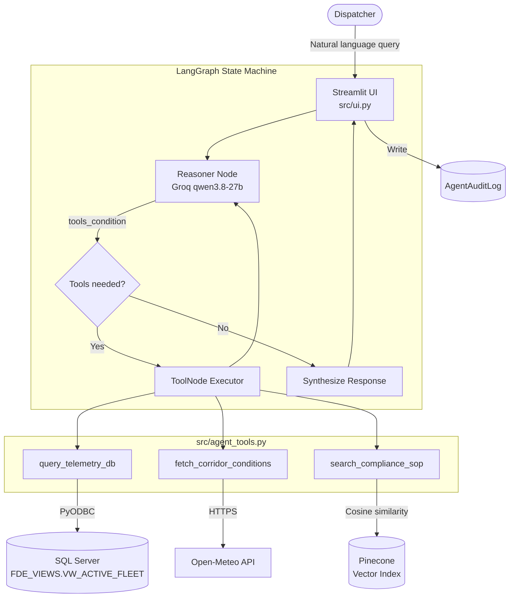

# Cold-Chain Logistics — AI Dispatch & Telemetry Assistant

---

## The Problem That Started This

Picture a dispatcher sitting at 2 AM, staring at three different screens.

One has a spreadsheet with raw sensor readings — column names like `IOT_TEMP_VAL_C` and `CGO_COND_CD` that mean nothing unless you've memorized the internal data dictionary. Another screen has a weather portal open for the Southern California corridor. The third has a 47-page SOP PDF that he's ctrl+F-ing for the word "perishable."

A refrigerated truck carrying fresh produce is somewhere near Los Angeles. The reefer unit might be failing. He has maybe 90 minutes to make a call before the cargo is unsalvageable — and he's copy-pasting GPS coordinates between tabs.

That's not a made-up scenario. That's just... logistics operations on a normal Tuesday.

This project is my attempt at building something that collapses those three screens into one conversation.

---

## What It Actually Does

You type a question in plain English. The system figures out what data it needs, goes and gets it, cross-references it with live weather at the vehicle's location, checks the compliance SOP for the relevant cargo type, and hands you back a structured incident report — with citations.

Under the hood it's a LangGraph ReAct agent wired up to three tools:

- **SQL telemetry queries** — against a secured read-only view on top of Microsoft SQL Server, so the AI never touches raw tables
- **Live corridor weather** — via Open-Meteo's REST API, using the vehicle's GPS coordinates
- **SOP vector search** — semantic retrieval from compliance documents indexed in Pinecone

The whole thing runs as a Streamlit app with a dispatch console and a separate audit log viewer (password-gated). Every tool call, every result, every response gets written to a database audit table automatically.

---

## Stack at a Glance

| Layer | Tech |
|---|---|
| Agent Orchestration | LangGraph 1.2.11 (ReAct state machine) |
| Primary LLM | Groq — `qwen/qwen3.8-27b` |
| Fallback LLM | Local Ollama — `qwen3:8b` |
| Vector Store | Pinecone Serverless |
| Embeddings | HuggingFace `BAAI/bge-m3` (local, CPU) |
| Database | Microsoft SQL Server 2022 (Docker) |
| ORM / Driver | SQLAlchemy + pyodbc |
| Frontend | Streamlit 1.62.0 |
| Weather API | Open-Meteo (free, no key needed) |
| Deployment | GitHub Actions → AWS EC2 → systemd |

---

## Architecture



The graph is cyclical — the reasoner keeps calling tools until it has everything it needs, then writes the final response. LangGraph's `MemorySaver` handles thread-level persistence, so conversation context carries across turns.

---

## Project Structure

```
cold-chain-logistics-FDE-Project/
│
├── .github/workflows/
│   └── deploy.yml              # Manual EC2 SSH deploy via GitHub Actions
├── .streamlit/
│   └── config.toml             # Disables file watcher (cleaner production behaviour)
├── data/
│   ├── cache/                  # MD5 hash cache — skip re-ingesting unchanged SOPs
│   ├── policy/                 # SOP documents (Markdown, PDF, etc.)
│   ├── raw/                    # Raw fleet CSV dataset (~32k rows, 15MB)
│   └── source/                 # Kaggle dataset reference link
├── docs/
│   └── instrutions.md          # Original setup and deployment walkthrough
├── scripts/
│   ├── ingest_legacy_data.py   # Load CSV into SQL Server
│   ├── ingest_sop_pinecone.py  # Chunk + embed + upsert SOPs into Pinecone
│   └── setup_security_and_view.sql  # Create views, roles, audit table
├── src/
│   ├── prompts/
│   │   └── system_prompt.txt   # Strict 3-section response format prompt
│   ├── agent_tools.py          # Tool definitions for the LangGraph agent
│   ├── orchestrator.py         # LangGraph graph + CLI test loop
│   └── ui.py                   # Streamlit dual-mode console
├── .env.example                # Template — copy to .env and fill in keys
├── requirements.txt
└── README.md
```

---

## Setup

### Prerequisites

- Python 3.12
- Docker (for SQL Server)
- Microsoft ODBC Driver 18 for SQL Server
  - Ubuntu: install via Microsoft APT (`msodbcsql18`, `unixodbc-dev`)
  - Windows: download MSI from Microsoft
- A Pinecone account (free tier works fine)
- A Groq API key — get one free at [console.groq.com](https://console.groq.com)
- Ollama installed locally (optional, used as offline fallback)

---

### 1. Clone & install

```bash
git clone https://github.com/your-username/cold-chain-logistics-FDE-Project.git
cd cold-chain-logistics-FDE-Project

python -m venv venv

# Linux / macOS
source venv/bin/activate

# Windows PowerShell
.\venv\Scripts\Activate.ps1

pip install -r requirements.txt
```

---

### 2. Spin up SQL Server

```bash
docker run -e "ACCEPT_EULA=Y" \
  -e "MSSQL_SA_PASSWORD=FdeEnterprisePass123!" \
  -p 1433:1433 \
  --name legacy-mssql \
  -d mcr.microsoft.com/mssql/server:2022-latest
```

---

### 3. Configure environment

Copy `.env.example` to `.env` and fill in your keys:

```env
# Database
SQL_SERVER_HOST=localhost
SQL_SERVER_PORT=1433
SQL_ADMIN_USER=sa
SQL_ADMIN_PASSWORD=FdeEnterprisePass123!
SQL_AGENT_USER=USR_FDE_RO
SQL_AGENT_PASSWORD=AgentPassword2026!

# Vector Store
PINECONE_API_KEY=your_pinecone_key_here

# LLM — Groq as primary, local Ollama qwen3:8b as fallback
Agent_llm=GROQ
GROQ_API_KEY=your_groq_key_here
GROQ_MODEL=qwen/qwen3.8-27b

# Embeddings (LOCAL = HuggingFace CPU, no API key needed)
Embeddings_model=LOCAL
Local_Embedding_Model=BAAI/bge-m3
```

Other `Agent_llm` options: `GEMINI`, `OPENAI`, `DEEPSEEK`, `OLLAMA`

---

### 4. Load data & set up the database

```bash
# Ingest raw CSV into SQL Server
python scripts/ingest_legacy_data.py
```

Then run `scripts/setup_security_and_view.sql` as `sa` (via Azure Data Studio, VS Code MSSQL extension, or `sqlcmd`). This creates:
- The `FDE_VIEWS` schema
- `VW_ACTIVE_FLEET` — the semantic view the agent queries
- `USR_FDE_RO` — restricted read-only user
- `AgentAuditLog` — audit table

The audit table DDL (run as `sa`):
```sql
CREATE TABLE FDE_VIEWS.AgentAuditLog (
    LogID INT IDENTITY(1,1) PRIMARY KEY,
    Timestamp DATETIME DEFAULT GETDATE(),
    SessionID VARCHAR(50),
    NodeExecuted VARCHAR(50),
    ToolName VARCHAR(100),
    Content NVARCHAR(MAX)
);

GRANT INSERT ON FDE_VIEWS.AgentAuditLog TO USR_FDE_RO;
```

---

### 5. Ingest SOPs into Pinecone

```bash
python scripts/ingest_sop_pinecone.py
```

Supports Markdown, PDF, TXT, CSV, and XLSX. Uses MD5 hashing to skip files that haven't changed, and auto-removes deleted documents from the index.

---

### 6. Run

```bash
streamlit run src/ui.py
```

Open `http://localhost:8501`.

---

## Environment Variables Reference

| Variable | Required | Default | Notes |
|---|---|---|---|
| `SQL_SERVER_HOST` | No | `localhost` | EC2 IP for remote deployments |
| `SQL_SERVER_PORT` | No | `1433` | Standard SQL Server port |
| `SQL_ADMIN_USER` | Yes | — | Used by ingestion scripts and audit viewer |
| `SQL_ADMIN_PASSWORD` | Yes | — | |
| `SQL_AGENT_USER` | No | `USR_FDE_RO` | Read-only agent DB user |
| `SQL_AGENT_PASSWORD` | Yes | — | |
| `PINECONE_API_KEY` | Yes | — | |
| `Agent_llm` | No | `GROQ` | `GROQ`, `GEMINI`, `OPENAI`, `DEEPSEEK`, `OLLAMA` |
| `GROQ_API_KEY` | If GROQ | — | |
| `GROQ_MODEL` | No | `qwen/qwen3.8-27b` | |
| `GEMINI_API_KEY` | If GEMINI | — | Also accepts `GOOGLE_API_KEY` |
| `GEMINI_MODEL` | No | `gemini-3.8-flash` | |
| `OPENAI_API_KEY` | If OPENAI | — | |
| `DEEPSEEK_API_KEY` | If DEEPSEEK | — | |
| `Embeddings_model` | No | `LOCAL` | `LOCAL` or `OPENAI` |
| `Local_Embedding_Model` | No | `BAAI/bge-m3` | Any HuggingFace sentence-transformer |

---

## What a Real Query Looks Like

> *"Find active shipments near LA, check the corridor weather, and tell me if the temperature violates the SOP for fresh perishables."*

**Step 1 — telemetry lookup:**
```sql
SELECT TOP 5 Timestamp, Latitude, Longitude, Current_Temperature_C,
       Cargo_Condition_Code, Risk_Classification, Delay_Probability
FROM FDE_VIEWS.VW_ACTIVE_FLEET
WHERE Latitude BETWEEN 33.5 AND 34.0
  AND Longitude BETWEEN -118.5 AND -117.8;
```
Returns: temp `5.2°C`, risk `High`, delay probability `0.54`

**Step 2 — corridor weather:**
Open-Meteo at `(33.51, -117.04)` → ambient `28.4°C`, wind `14.2 km/h`, congestion index `8.5/10`

**Step 3 — SOP check:**
Pinecone retrieves the fresh perishables clause: allowable range `0°C – 4°C`. Current reading is a **Critical Breach**.

**Agent output:**
```
### 1. Executive Summary
Shipment at (33.51, -117.04) is at 5.2°C — above the 4.0°C critical threshold
for fresh perishables. High ambient heat and corridor disruption compound the risk.

### 2. Telemetry & Environment Analysis
| Location       | Cargo Temp | Risk        | Ambient | Congestion |
|----------------|------------|-------------|---------|------------|
| 33.51, -117.04 | 5.2°C      | High (0.54) | 28.4°C  | 8.5 / 10   |

### 3. Required Action Plan
1. Contact driver immediately — restart auxiliary cooling unit.
2. If ETA delay > 1 hour, divert to nearest emergency cold-storage facility.

SOP Citation: Cold_Chain_Incident_SOP_v2.md — Section 1, Temperature Control & Spoilage Prevention
```

---

## Security Notes

A few things worth knowing before deploying this anywhere serious:

- The agent user (`USR_FDE_RO`) only has `SELECT` on the semantic view and `INSERT` on the audit log. It can't touch raw tables or alter schemas.
- LLM-generated SQL is passed to the DB after a basic `SELECT`-check. Fine for a controlled internal tool, but not hardened against sophisticated prompt injection.
- The admin portal does plain string comparison against env vars. It's a password gate, not an auth system. Don't expose it on a public IP without putting something real in front of it.
- Audit log failures are silent by design — the agent keeps running even if the DB write fails.

---

## Deployment (EC2 + GitHub Actions)

The repo includes a manual-dispatch GitHub Actions workflow that SSHs into an EC2 instance and restarts the service:

```bash
cd /home/ubuntu/cold-chain-logistics-FDE-Project
git pull origin main
source venv/bin/activate
sudo systemctl restart streamlit
```

Required GitHub secrets: `EC2_HOST`, `EC2_USER`, `EC2_SSH_KEY`

The Streamlit app runs as a `systemd` service:

```ini
[Unit]
Description=Streamlit Cold-Chain Dispatch Console
After=network.target

[Service]
User=ubuntu
WorkingDirectory=/home/ubuntu/cold-chain-logistics-FDE-Project
ExecStart=/home/ubuntu/cold-chain-logistics-FDE-Project/venv/bin/streamlit run src/ui.py --server.port=8501 --server.address=0.0.0.0
Restart=always

[Install]
WantedBy=multi-user.target
```

---

## Testing Without the Full Stack

Both entry points run standalone for quick verification:

```bash
# Test all three agent tools directly
python src/agent_tools.py

# Interactive CLI chat loop (no Streamlit needed)
python src/orchestrator.py
```

The orchestrator CLI is particularly useful for debugging prompt behaviour without the UI overhead.

---

## What I'd Do Differently Next Time

A few honest notes on where this could be better:

- **Parameterized queries** instead of raw text-to-SQL would close the injection surface properly
- **A full `docker-compose.yml`** covering SQL Server + the app together would make onboarding much less painful
- **Async audit logging** via a queue (Redis, SQS) so a DB hiccup doesn't silently drop the audit trail
- **Proper auth** — OAuth2 or at minimum JWT sessions instead of env-var string comparison
- **A `tests/` directory** with mocked services for Pinecone, SQL Server, and Open-Meteo

None of these are blockers for what this project is demonstrating, but they'd be the first things I'd tackle before putting this in front of real users.

---

*Dataset sourced from Kaggle — see `data/source/data.txt` for the original link.*
